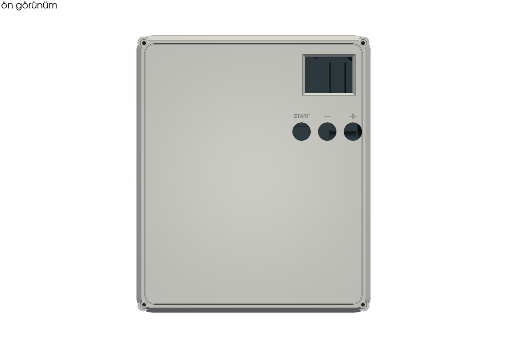
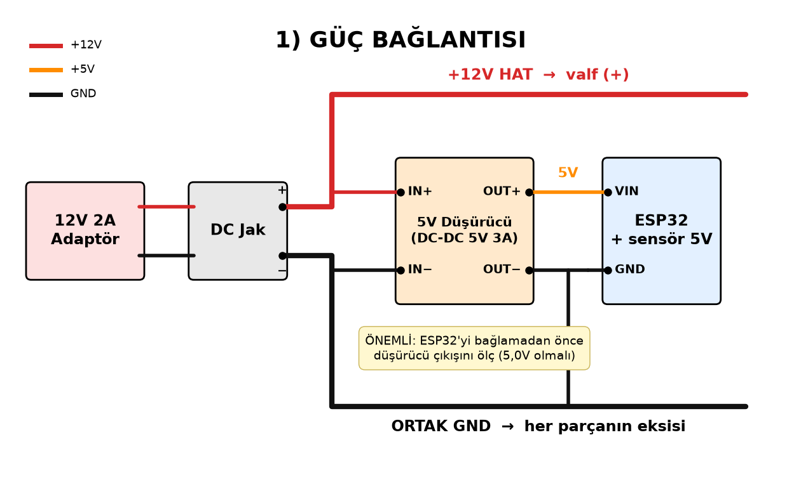
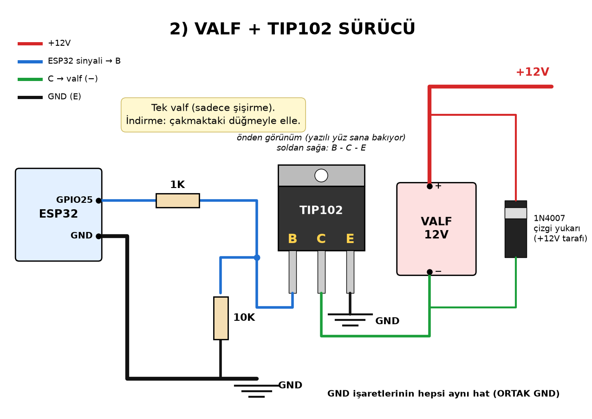
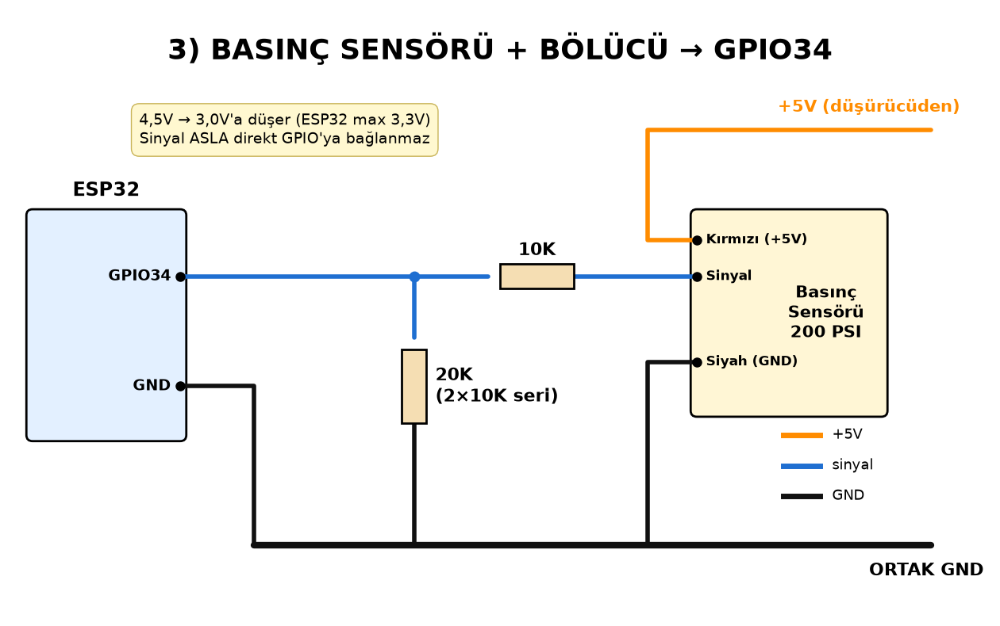
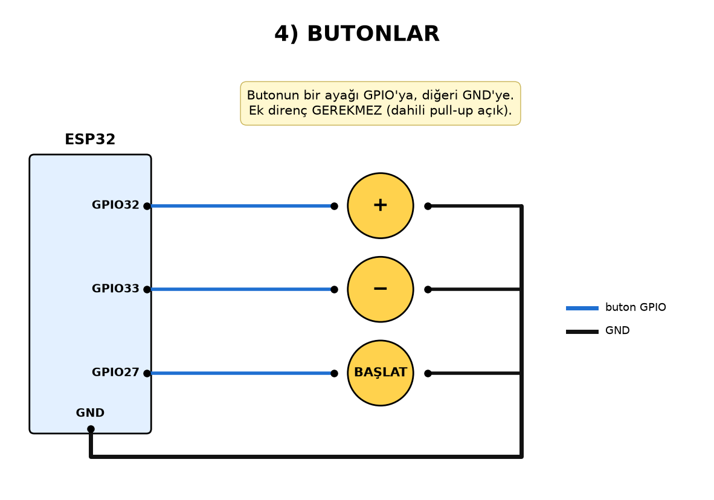
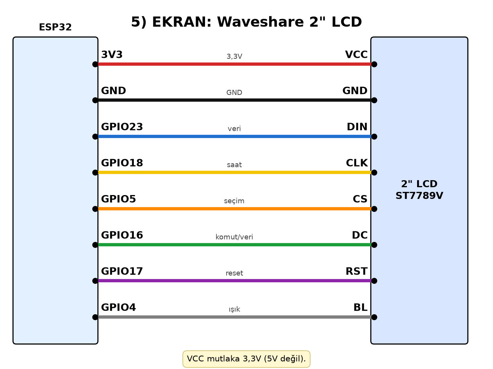

# ESP32 Lastik Şişirme İstasyonu / ESP32 Tire Inflator



[🇹🇷 Türkçe](#türkçe) · [🇬🇧 English](#english)

---

## Türkçe

### Genel bakış
Kompresör hattına takılan, hedef basınca kadar lastiği otomatik şişiren ESP32 istasyonu. Hedefi butonlarla ayarlarsın, BAŞLAT'a basınca 12V NC solenoid valf kısa pulslarla açılır; her pulstan sonra basınç oturur ve ölçülür, hedefe gelince durur.

### Özellikler
- **Tek basışla otomatik şişirme:** hedefi ayarla, BAŞLAT'a bir kez bas, hedefe gelince kendisi durur
- Boş lastikte önce uzun ilk puls; ~25 psi üstünde kısa pulslar ve sık ölçüm, hedef aşılmaz
- Her işte dolum hızını öğrenir; farklı lastik/kompresöre kendini uyarlar
- psi / bar / kPa (0,1 psi / 0,05 bar / 5 kPa adım), hedef kalıcı hafızada (NVS)
- Bitişte **3 kısa + 1 uzun bip**
- Günlük şişirme sayacı
- Büyük dijital kart ekranı (LovyanGFX, 2" ST7789V)
- **Telefon paneli:** cihazın kendi Wi-Fi ağı üzerinden, internet gerekmez (BAŞLAT/DURDUR, + / −, birim)
- **OTA:** ArduinoOTA ve `http://192.168.4.1/update` web yükleme
- Fazla basınç uyarısı; güvenlik: 10 bar kesme, sensör kopuk/kısa, lastik yok, basınç artmıyor, zaman aşımı
- İsteğe bağlı otomatik tahliye valfi (GPIO26)

### Wi-Fi / telefon paneli
| | |
|---|---|
| Wi-Fi ağı | `Lastik-Sisirme` |
| Şifre | `123456789` |
| Panel | http://192.168.4.1 |

Telefonu bu ağa bağla, tarayıcıda paneli aç. Wi-Fi şifresi `firmware/src/main.cpp` içindeki `AP_SIFRE` satırından değiştirilebilir.

> ℹ️ **OTA şifresiz:** Kablosuz güncelleme şifre sormaz. `Lastik-Sisirme` ağına bağlanıp `http://192.168.4.1/update` sayfasından `.bin` dosyasını seçmen yeterli. Wi-Fi şifresini bilen herkes yazılım yükleyebilir.

### Pin bağlantıları
| İşlev | GPIO |
|---|---|
| `+` buton | 32 |
| `−` buton | 33 |
| BAŞLAT buton (kısa: başlat/durdur, uzun: birim değiştir) | 27 |
| Buzzer | 13 |
| Valf (TIP102 üzerinden) | 25 |
| Basınç sensörü | 34 |

### Malzemeler (BOM)
Ayrıntı ve linkler: [`BOM.csv`](BOM.csv). Elektronik + valf ≈ **2.815 TL** (Motorobit, 10/2026).
| Parça | Özellik |
|---|---|
| ESP32 DevKit | ESP-WROOM-32 |
| Solenoid valf | 2W-025-08, 12V DC, NC, G1/4 |
| Basınç sensörü | G1/4, 0–200 psi, 5V, 0,5–4,5V çıkış |
| TIP102 + 1K + 10K + 1N4007 | Valf sürücü |
| 10k + 20k (2×10k) | Sensör bölücü |
| Waveshare 2" ST7789V | 240×320 SPI LCD |
| 3× 16 mm buton (+, −, BAŞLAT), buzzer, DC jak 5.5×2.1, 12V 2A adaptör, 5V buck | |
| 1/4" fittings | nipeller, 2× T, kör tapa, 3/4→1/4 redüksiyon |

### Bağlantı
| Parça | Bağlantı |
|---|---|
| Güç | 12V adaptör → DC jak; 5V buck → ESP32 VIN + sensör |
| Sensör | sinyal → 10k → GPIO34 → 20k → GND |
| Valf | GPIO25 → 1K → TIP102 B; B → 10K → GND; E → GND; C → valf(−); valf(+) → 12V; 1N4007 katot +12V |
| Butonlar | GPIO32 +, GPIO33 −, GPIO27 BAŞLAT → GND |
| Ekran | VCC 3V3, DIN 23, CLK 18, CS 5, DC 16, RST 17, BL 4 |

| | | |
|---|---|---|
|  |  |  |
|  |  | |

### Derleme / yükleme
```bash
pip install platformio
cd firmware
pio run -t upload
pio device monitor
```
Kullanım: `+`/`−` hedef · `BAŞLAT` kısa: başlat/durdur · `BAŞLAT` uzun: birim.

Panel değiştirildiyse: `python3 tools/panel_uret.py` (panel_src.html → panel.h). Fontlar: `tools/vlw_uret.py`.

### Baskı
`enclosure/3mf/` içinde iki tabla (PrusaSlicer/Bambu Studio). PLA: 0,28 mm, 2 duvar, %8 gyroid, 3 üst/3 alt, 220/60 °C, destek yok (`pla.ini`). Gövde ~6,5 sa / 269 g, kapak+kelepçe+takoz ~2,8 sa / 134 g. PETG: 245/75 °C (`petg.ini`). Model kaynak: `enclosure/kutu.py` (CadQuery).

### Kalibrasyon
1. Hortum basınçsızken `+` ve `−` basılı tutarak aç → sıfır kaydedilir.
2. Güvenilir bir manometre ile karşılaştır; gerekiyorsa `main.cpp` içindeki `SENSOR_BAR_MAX` / `SENSOR_V_MIN` değerlerini düzelt.

### Güvenlik
- Kompresör çıkışı ≤10 bar olmalı; hatta mekanik emniyet ventili kullan.
- Lastiğin üzerindeki azami basıncı asla aşma. Bu cihaz yardımcıdır, ölçümü kontrol et.
- PLA ~55 °C'de yumuşar: güneşten, sıcak araç içinden ve kompresörden uzak tut ya da PETG bas.

### Gelecek: tahliye valfi
Büyük 2W-160-15 (G1/2) şişirme valfi olur, küçük valf tahliye T'sine taşınır (susturucu yan duvardaki kırılabilir zardan çıkar). 2. TIP102 + 1N4007 + 1K + 10K → GPIO26. `platformio.ini` içinde `build_flags = -DTAHLIYE_VALFI=1` satırını aç.

---

## English

### Overview
An ESP32 station that sits on a compressor line and inflates a tire to a set pressure. Set the target with the buttons and press START: a 12 V normally-closed solenoid valve opens in short pulses, pressure settles and is measured after each pulse, and it stops at the target.

### Features
- **One-press auto inflate:** set the target, press BAŞLAT (START) once, it stops at the target
- Long first pulse on an empty tire; above ~25 psi short pulses with frequent checks, no overshoot
- Learns the fill rate on every job, adapts to different tires/compressors
- psi / bar / kPa (0.1 psi / 0.05 bar / 5 kPa steps), target stored in NVS
- Finish beep: **3 short + 1 long**
- Daily inflation counter
- Big digital card UI (LovyanGFX, 2" ST7789V)
- **Phone panel** over the device's own Wi-Fi, no internet needed (start/stop, + / −, unit)
- **OTA:** ArduinoOTA and web upload at `http://192.168.4.1/update`
- Over-pressure warning; safety: 10 bar cut-off, sensor open/short, no tire, no rise, timeout
- Optional automatic exhaust valve on GPIO26

### Wi-Fi / phone panel
| | |
|---|---|
| Network (SSID) | `Lastik-Sisirme` |
| Password | `123456789` |
| Panel | http://192.168.4.1 |

Change the Wi-Fi password via `AP_SIFRE` in `firmware/src/main.cpp`.

> ℹ️ **OTA has no password:** connect to `Lastik-Sisirme`, open `http://192.168.4.1/update` and pick the `.bin`. Anyone who knows the Wi-Fi password can upload firmware.

### Pinout
| Function | GPIO |
|---|---|
| `+` button | 32 |
| `−` button | 33 |
| BAŞLAT/START button (short: start/stop, long: change unit) | 27 |
| Buzzer | 13 |
| Valve (via TIP102) | 25 |
| Pressure sensor | 34 |

### Bill of materials
See [`BOM.csv`](BOM.csv) (Turkish sellers, prices in TRY). Electronics + valve ≈ 2,815 TRY (10/2026). Main parts: ESP32 DevKit; 2W-025-08 12 V NC G1/4 valve; G1/4 0–200 psi 0.5–4.5 V pressure sensor; TIP102 + 1 kΩ + 10 kΩ + 1N4007; 10 kΩ/20 kΩ divider; Waveshare 2" ST7789V; 3× 16 mm push buttons; 5.5×2.1 DC jack; 12 V 2 A adapter; 5 V buck; 1/4" fittings.

### Wiring
| Part | Connection |
|---|---|
| Power | 12 V adapter → DC jack; 5 V buck → ESP32 VIN + sensor |
| Sensor | signal → 10k → GPIO34 → 20k → GND |
| Valve | GPIO25 → 1K → TIP102 B; B → 10K → GND; E → GND; C → valve(−); valve(+) → 12 V; 1N4007 across valve, cathode to +12 V |
| Buttons | GPIO32 +, GPIO33 −, GPIO27 BAŞLAT → GND (internal pull-ups) |
| Display | VCC 3V3, DIN 23, CLK 18, CS 5, DC 16, RST 17, BL 4 |

Diagrams are in [`wiring/`](wiring) (labels in Turkish: GÜÇ = power, VALF = valve, BUTONLAR = buttons, EKRAN = display).

### Build and flash
```bash
pip install platformio
cd firmware
pio run -t upload
pio device monitor
```
After editing the panel: `python3 tools/panel_uret.py`.

Usage: `+`/`−` sets the target · `BAŞLAT` (START) short press: start/stop · `BAŞLAT` long press: cycle units.

### Printing
Two plates in `enclosure/3mf/`. PLA: 0.28 mm layers, 2 walls, 8 % gyroid, 3 top/3 bottom, 220/60 °C, no supports (`pla.ini`). Body ~6.5 h / 269 g; lid + clamps + spacer ~2.8 h / 134 g. PETG: 245/75 °C (`petg.ini`). Parametric source: `enclosure/kutu.py` (CadQuery; run it, then `render.py` for previews). File names: govde = body, kapak = lid, kelepce = clamp, takoz = valve spacer.

### Calibration
1. With the hose unpressurized, power on while holding `+` and `−` to store the zero offset.
2. Compare against a trusted gauge and adjust `SENSOR_BAR_MAX` / `SENSOR_V_MIN` in `main.cpp` if needed.

### Safety notes
- Compressor output must be ≤10 bar; use a mechanical relief valve on the line.
- Never exceed the maximum pressure printed on the tire. Double-check readings.
- PLA softens around 55 °C: keep it out of the sun, hot cars and away from the compressor, or print in PETG.

### Future upgrade: exhaust valve
The larger 2W-160-15 (G1/2) becomes the inflate valve and the small valve moves to the exhaust tee (muffler exits through the break-out membrane in the side wall). Add a second TIP102 + 1N4007 + 1K + 10K on GPIO26 and enable `build_flags = -DTAHLIYE_VALFI=1` in `platformio.ini`.

## License
Code: MIT. Hardware & docs: CC BY 4.0. © 2026 esp32-lastik-sisirme contributors. See [LICENSE](LICENSE).
